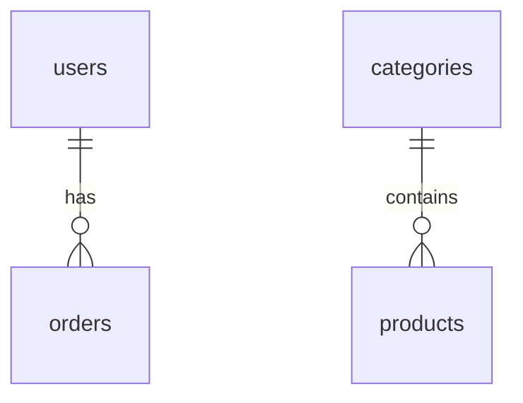

# Flobase

A unified schema-driven DSL for modern backend engineering. Define relational models, validation constraints, and API contracts once in declarative YAML, and deterministically compile production-grade PostgreSQL DDL, OpenAPI 3.1 specifications, and Mermaid entity-relationship diagrams.

<p align="center">
  <picture>
    <source media="(prefers-color-scheme: dark)" srcset="assets/logo-full.svg">
    
  </picture>
</p>

<p align="center">
  <a href="https://www.npmjs.com/package/flobase"></a>
  <a href="https://www.npmjs.com/package/flobase-mcp"></a>
  <a href="https://www.npmjs.com/package/flobase-editor"></a>
  <a href="https://github.com/flovo-labs/flobase/actions"></a>
  <a href="LICENSE"></a>
</p>

---

## Table of Contents

- [The Problem: Schema Drift](#the-problem-schema-drift)
- [The Flobase Architecture](#the-flobase-architecture)
- [Monorepo Packages](#monorepo-packages)
- [Quick Start](#quick-start)
- [Comprehensive Schema Specification](#comprehensive-schema-specification)
  - [Supported Data Types](#supported-data-types)
  - [Relationships & Foreign Keys](#relationships--foreign-keys)
  - [Endpoint Definitions](#endpoint-definitions)
- [CLI Reference](#cli-reference)
  - [flobase init](#flobase-init)
  - [flobase build](#flobase-build)
  - [flobase editor](#flobase-editor)
- [Output Artifacts & Production Integration](#output-artifacts--production-integration)
  - [PostgreSQL DDL Migration Strategy](#postgresql-ddl-migration-strategy)
  - [OpenAPI 3.1 Contract Usage](#openapi-31-contract-usage)
  - [Mermaid ER Diagrams](#mermaid-er-diagrams)
- [AI Assistant Integration (Model Context Protocol)](#ai-assistant-integration-model-context-protocol)
  - [Configuration: Cursor](#configuration-cursor)
  - [Configuration: Claude Desktop](#configuration-claude-desktop)
  - [Tool Specifications](#tool-specifications)
- [Visual Canvas Editor (`flobase-editor`)](#visual-canvas-editor-flobase-editor)
- [Programmatic Node.js SDK](#programmatic-nodejs-sdk)
- [Development & Contributing](#development--contributing)
- [License](#license)

---

## The Problem: Schema Drift

Backend architectures frequently manage duplicate representations of the same underlying data models:

1. **Database layer**: PostgreSQL DDL files, migration scripts, primary keys, and foreign key indexes.
2. **API layer**: OpenAPI / Swagger YAML documents with JSON schema validation and status codes.
3. **Documentation layer**: Entity-relationship diagrams, architectural diagrams, and team wiki entries.

When models evolve, engineers often update migrations while neglecting OpenAPI files, or update API payload definitions without adding database constraints. This desynchronization ("schema drift") leads to runtime validation crashes, unindexed foreign key lookups, and inaccurate client SDK generations.

Flobase eliminates schema drift by providing a single declarative source of truth (`schema.yaml`). Rather than writing migrations and OpenAPI definitions by hand, engineers write high-level schema manifests that Flobase deterministically compiles into production code.

---

## The Flobase Architecture

```
               +--------------------------------------+
               |             schema.yaml              |
               | (Declarative Schema & API Manifest)  |
               +------------------+-------------------+
                                  |
               +------------------v-------------------+
               |             flobase                  |
               |    (Zod Ast Parser & Compiler)       |
               +-----+------------+-------------+-----+
                     |            |             |
        +------------v--+  +------v-------+  +--v------------+
        |  PostgreSQL   |  | OpenAPI 3.1  |  |  Mermaid ER   |
        |      DDL      |  | Specification|  |    Diagram    |
        |  (schema.sql) |  | (openapi.yml)|  | (ER_DIAGRAM)  |
        +---------------+  +--------------+  +---------------+
```

The system operates across three core boundaries:
- **Zero Hallucination Engine**: All compilers run deterministic code. No external cloud models or generative LLMs are invoked in the standard compilation pipeline.
- **Topological Sorting**: Relational dependency graphs are resolved prior to DDL generation, ensuring child tables with foreign keys are emitted strictly after parent tables.
- **Bi-directional Round-Trip**: The visual canvas utilizes comment-preserving Abstract Syntax Tree (AST) mutations via `yaml.parseDocument` to ensure developer comments and formatting remain intact.

---

## Monorepo Packages

Flobase is distributed across three targeted packages:

| Package | Purpose | Version | Installation |
| :--- | :--- | :--- | :--- |
| **`flobase`** | Core command-line compiler, validator, and Node.js SDK | `0.1.0` | `npm install -g flobase` or `npx flobase` |
| **`flobase-mcp`** | Model Context Protocol server exposing deterministic tools to Cursor, Windsurf, and Claude | `0.1.0` | `npx -y flobase-mcp` |
| **`flobase-editor`** | Visual drag-and-drop canvas application built with React Flow | `0.1.0` | `npx flobase-editor` or `flobase editor` |

---

## Quick Start

### 1. Installation

Flobase can be executed on demand using `npx` or installed globally:

```bash
# Global installation
npm install -g flobase

# Or execute on demand
npx flobase --help
```

### 2. Scaffold a Starter Project

Run `init` inside your project root to generate a starter `schema.yaml` manifest and configure VS Code autocomplete:

```bash
flobase init
```

This creates:
- `schema.yaml`: Sample architecture schema with models, relational fields, and CRUD endpoints.
- `.vscode/settings.json`: Configures the JSON schema validator for real-time editor linting.

### 3. Compile Target Artifacts

Compile the YAML schema into standard output files:

```bash
flobase build schema.yaml
```

Generated output structure:
```text
output/
|-- schema.sql       # Topological PostgreSQL DDL statements
|-- openapi.yaml     # Validated OpenAPI 3.1 REST specification
`-- ER_DIAGRAM.md    # Mermaid ER diagram markdown file
```

---

## Comprehensive Schema Specification

Below is an annotated `schema.yaml` demonstrating all supported relational and architectural features:

```yaml
version: "0.1.0"
name: "ECommerceCore"
description: "Production transactional schema for accounts, catalogs, and orders"

models:
  # User Model
  User:
    tableName: "users"
    description: "Registered platform customer or internal staff account"
    fields:
      id:
        type: uuid
        primary: true
        description: "Primary key identifier"
      email:
        type: string
        unique: true
        required: true
        description: "Account login email"
      fullName:
        type: string
        required: true
      role:
        type: enum
        values: ["customer", "merchant", "admin"]
        default: "customer"
      metadata:
        type: json
        description: "Custom preferences and telemetry payloads"
      isActive:
        type: bool
        default: true
      createdAt:
        type: timestamp
        required: true

  # Category Model (Referenced by Product)
  Category:
    tableName: "categories"
    fields:
      id:
        type: uuid
        primary: true
      slug:
        type: string
        unique: true
        required: true
      title:
        type: string
        required: true

  # Product Model
  Product:
    tableName: "products"
    fields:
      id:
        type: uuid
        primary: true
      categoryId:
        type: uuid
        references: "Category.id"
        description: "Foreign key pointing to categories table"
      sku:
        type: string
        unique: true
        required: true
      price:
        type: decimal
        required: true
      inventoryCount:
        type: int
        default: 0
      description:
        type: text

  # Order Model
  Order:
    tableName: "orders"
    fields:
      id:
        type: uuid
        primary: true
      userId:
        type: uuid
        references: "User.id"
      totalAmount:
        type: decimal
        required: true
      orderStatus:
        type: enum
        values: ["pending", "processing", "shipped", "delivered", "cancelled"]
        default: "pending"
      placedAt:
        type: timestamp
        required: true

endpoints:
  - method: GET
    path: /api/products
    summary: "List all catalog items"
    model: Product

  - method: POST
    path: /api/products
    summary: "Create catalog item"
    model: Product

  - method: GET
    path: /api/orders
    summary: "List customer orders"
    model: Order

  - method: POST
    path: /api/orders
    summary: "Submit new order"
    model: Order
```

### Supported Data Types

| Flobase Type | PostgreSQL Type | OpenAPI 3.1 Type | Notes |
| :--- | :--- | :--- | :--- |
| `uuid` | `UUID` | `string` (`format: uuid`) | Defaults to PostgreSQL primary key type |
| `string` | `VARCHAR(255)` / `TEXT` | `string` | General string representation |
| `text` | `TEXT` | `string` | Unbounded text content |
| `int` / `integer` | `INTEGER` | `integer` (`format: int32`) | 32-bit signed integer |
| `decimal` / `float`| `NUMERIC(12,2)` / `DECIMAL` | `number` | Precise currency and decimal amounts |
| `bool` / `boolean`| `BOOLEAN` | `boolean` | True/False boolean flags |
| `timestamp` | `TIMESTAMP WITH TIME ZONE` | `string` (`format: date-time`)| Standard UTC timestamps |
| `date` | `DATE` | `string` (`format: date`) | Calendar dates without times |
| `json` | `JSONB` | `object` | Binary structured JSON documents |
| `enum` | `VARCHAR(50)` + `CHECK` | `string` (`enum: [...]`) | Inline PostgreSQL check constraint |

### Relationships & Foreign Keys

Relationships are declared directly on field definitions using the `references` directive:

```yaml
fields:
  userId:
    type: uuid
    references: "User.id"
```

The compiler interprets this notation, extracts the foreign key constraint, ensures `users` is created before the dependent table in DDL outputs, and wires the Mermaid connector edge.

---

## CLI Reference

### `flobase init`

Scaffolds a starter schema in the current working directory:
```bash
flobase init
```
Options:
- `-h, --help`: Displays command help.

### `flobase build <path>`

Compiles the target schema file into standard build artifacts:
```bash
flobase build schema.yaml
```
Options:
- `--dry-run`: Prints all generated SQL, OpenAPI YAML, and Mermaid ER diagrams directly to stdout without writing files to disk.
- `--ai`: Optional documentation helper that invokes Gemini to generate extended prose (`API_DOCS.md`). Core artifacts remain strictly deterministic.

### `flobase editor [path]`

Launches the visual drag-and-drop canvas editor in your local browser:
```bash
flobase editor schema.yaml
```

---

## Output Artifacts & Production Integration

### PostgreSQL DDL Migration Strategy

The generated `output/schema.sql` file contains ready-to-execute DDL statements ordered topologically:

```bash
# Execute directly against your PostgreSQL database
psql -h localhost -U postgres -d my_database -f output/schema.sql
```

For team migration pipelines, `output/schema.sql` can be integrated directly with tools like Flyway, Liquibase, or dbmate by wrapping it in an initial migration file.

### OpenAPI 3.1 Contract Usage

The generated `output/openapi.yaml` follows the official OpenAPI 3.1.0 specification. You can:
1. **Import directly**: Load `openapi.yaml` into Postman, Insomnia, or Swagger UI.
2. **Generate client SDKs**: Run `openapi-generator-cli` or `orval` to emit TypeScript, Go, or Python HTTP clients:
   ```bash
   npx @openapitools/openapi-generator-cli generate -i output/openapi.yaml -g typescript-axios -o ./src/api-client
   ```

### Mermaid ER Diagrams

The generated `output/ER_DIAGRAM.md` file renders visual entity relationships natively on GitHub and inside VS Code:



---

## AI Assistant Integration (Model Context Protocol)

Flobase provides an official Model Context Protocol (MCP) server that connects your schema models directly into AI IDEs such as Cursor, Windsurf, and Claude Desktop.

Instead of writing custom prompts or pasting schemas manually, AI assistants can query your schema's AST and validate changes through deterministic JSON-RPC tools.

### Configuration: Cursor

Add the following to your project's `.cursor/mcp.json` or global Cursor configuration:

```json
{
  "mcpServers": {
    "flobase": {
      "command": "npx",
      "args": ["-y", "flobase-mcp"]
    }
  }
}
```

### Configuration: Claude Desktop

Add the following block to your `claude_desktop_config.json`:

```json
{
  "mcpServers": {
    "flobase": {
      "command": "npx",
      "args": ["-y", "flobase-mcp"]
    }
  }
}
```

### Tool Specifications

Once connected, your AI assistant has access to four deterministic tools:

1. **`read_schema`**:
   - Accepts `{ "path": "schema.yaml" }`
   - Returns structured JSON representing models, fields, types, and relationships.
2. **`validate_schema`**:
   - Accepts `{ "path": "schema.yaml" }`
   - Validates syntax and referential foreign key integrity without crashing on malformed YAML.
3. **`generate_sql`**:
   - Accepts `{ "path": "schema.yaml", "dialect": "postgres" }`
   - Generates compiled SQL DDL for execution.
4. **`generate_er_diagram`**:
   - Accepts `{ "path": "schema.yaml" }`
   - Emits Mermaid ER diagram syntax.

#### Example Assistant Prompts
- *"Add a stripeCustomerId field to the User model and validate the schema."*
- *"Generate the updated PostgreSQL DDL for schema.yaml."*
- *"Show me an ER diagram of all relationships connected to Order."*

---

## Visual Canvas Editor (`flobase-editor`)

The visual editor allows developers to inspect and manipulate schema models on a 2D node canvas powered by React Flow:

- **Launch Command**: `npx flobase editor schema.yaml`
- **Port Allocation**: Canvas runs at `http://localhost:5173`, sync API runs at `http://localhost:3001`.
- **Comment-Safe Sync**: Moving nodes, renaming fields, or modifying types uses AST node replacement (`yaml.parseDocument` + `setIn`), preserving code comments and indentation.
- **Live OpenAPI 3.1 Preview**: A collapsible bottom drawer continuously renders the updated REST contract with instant syntax and validation feedback.

---

## Programmatic Node.js SDK

You can import Flobase compilation primitives directly into TypeScript and Node.js applications:

```typescript
import { parseAndValidateSchema } from "flobase/schema";
import { generatePostgresDDL } from "flobase/pg-generator";
import { generateOpenApiYaml } from "flobase/openapi-generator";
import { generateMermaidEr } from "flobase/er-generator";

const yamlSource = `
version: "0.1.0"
models:
  Account:
    fields:
      id:
        type: uuid
        primary: true
`;

const parsed = parseAndValidateSchema(yamlSource);
if (parsed.success && parsed.data) {
  const sql = generatePostgresDDL(parsed.data);
  const openapi = generateOpenApiYaml(parsed.data);
  const mermaid = generateMermaidEr(parsed.data);
}
```

---

## Development & Contributing

### Prerequisites
- Node.js >= 20.0.0
- npm >= 10.0.0

### Local Setup

```bash
# Clone repository
git clone https://github.com/flovo-labs/flobase.git
cd flobase

# Install dependencies across all workspace packages
npm install

# Compile all packages (CLI, MCP, Editor)
npm run build

# Run comprehensive test suite
npm test
```

Please review [CONTRIBUTING.md](CONTRIBUTING.md) for code formatting standards and pull request workflows.

---

## License

This project is licensed under the terms of the MIT License. See [LICENSE](LICENSE) for details.
